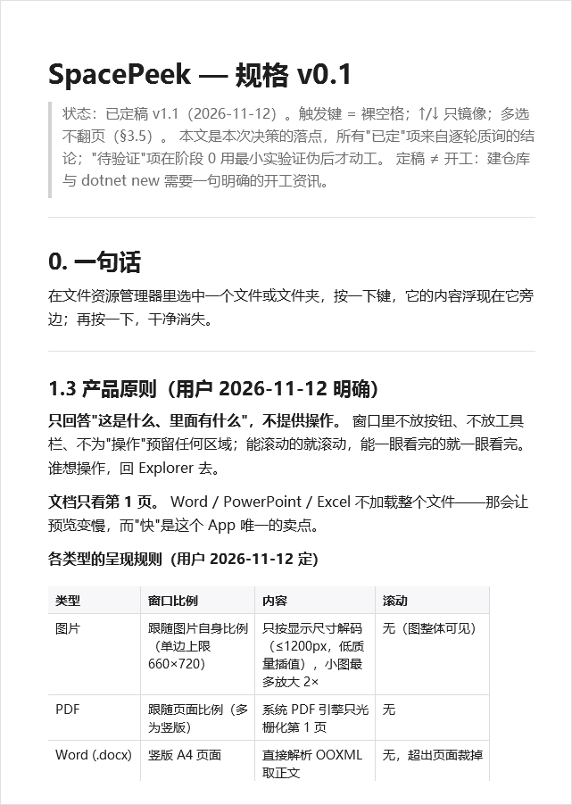
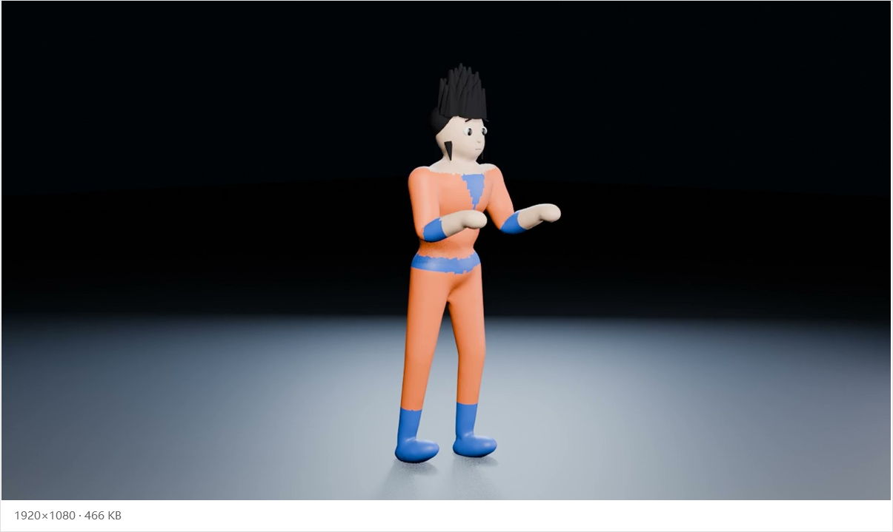

# 快速预览 · SpacePeek

> 在文件资源管理器里选中一个文件或文件夹，按一下**空格**，它的内容浮现在旁边；再按一下，干净消失。
>
> Windows 11 · 单文件绿色版 · 无管理员权限 · 无遥测


## 这是什么

macOS 的 Quick Look 用空格键预览文件，Windows 一直没有一个"按一下就看见"的等价物。这个项目补上它，并且做了别人没做的那件事：**文件夹结构预览**。

PowerToys Peek 只显示文件夹的元数据摘要，QL-Win/QuickLook 对文件夹也很有限。这里会直接把两层目录树、文件大小和数量统计画出来。

## 效果

| 文件夹 | Excel |
|---|---|
|  |  |

| Word | PDF |
|---|---|
|  |  |

| Markdown | 视频（第一帧） |
|---|---|
|  |  |

## 支持的格式

| 类型 | 说明 |
|---|---|
| 图片 | jpg / jpeg / png / bmp / gif / tif / ico / webp，按 EXIF 方向自动摆正 |
| 视频 | **第一帧**：mp4 / m4v / mov / mkv / avi / wmv / webm / mpg / mpeg / ts / flv |
| PDF | 第 1 页，按页面比例竖版显示 |
| Word | .doc / .docx，整页显示（系统预览组件截图，**不启动 Word**） |
| Excel | .xlsx / .xlsm 自研渲染（字体、填充、合并、日期格式照原样）；.xls 走 Excel 导出第 1 页 |
| PowerPoint | .ppt / .pptx，第 1 张幻灯片 |
| Markdown | 渲染后显示：标题、列表、引用、代码块、表格 |
| HTML | 用 WebView2 真渲染（失败时回退显示源码） |
| EPUB | 解析容器 → OPF → 正文，按书页展示 |
| 压缩包 | zip / jar / apk / nupkg / vsix / epub 的条目列表；**GBK 文件名自动纠正**，不乱码 |
| 文本 / 代码 | 100+ 扩展名，含 JSON / XML / YAML / TOML / SQL / 各种语言；README、LICENSE、Dockerfile 等无扩展名文件也认 |

## 速度（本机实测，i5 + 1.25× 缩放）

| 动作 | 首次 | 再次 |
|---|---|---|
| 文件夹 / 压缩包 / 文本 | 1–30 ms | 同左 |
| Excel（352 行 × 19 列） | ~150 ms | 同左 |
| 图片（1920×1080） | ~90 ms | 同左 |
| 视频第一帧 | ~370 ms | 同左 |
| PDF 第 1 页 | 110–300 ms | 同左 |
| Word / PPT（系统组件截图） | 380–930 ms | **60 ms**（缓存命中） |
| .xls（Excel 导出） | ~1.5 s | 60 ms（缓存命中） |

按空格到窗口出现，暖路径通常在 **150 ms 以内**。

## 使用

1. 下载 `SpacePeek.exe`，放到任意目录，双击运行；
2. 在资源管理器里选中文件，按**空格**；
3. 空格 / Esc 关闭，↑↓ 换选中项（HUD 不抢焦点，Explorer 的键盘行为不变）；
4. 托盘图标右键：设置、开机自启、清空缓存、关于、退出。

## 设计取舍

- **不抢焦点**：HUD 用 `WS_EX_NOACTIVATE`，预览时 Explorer 仍是活动窗口，选中项高亮不变。
- **不启动 Office**：Word/PPT 用系统预览组件在屏外渲染再截图，实测无 `WINWORD.EXE` 进程；只有旧版 `.xls` 才请 Excel 导出一次。
- **不滚动**：预览只负责"看一眼"，超出页面的内容直接裁掉，不提供滚动条。
- **零遥测**：不联网（除非你点"检查更新"，当前版本未实现）、不写注册表（开机自启除外）。

## 已知限制

- 仅支持 **Windows 11**；只在系统资源管理器里生效，第三方文件管理器（Files、Directory Opus 等）不响应。
- 加密 PDF 无法预览（会提示需要密码）。
- `.xls` 需要本机安装 Excel；未安装时显示文件信息卡。
- Excel 自研渲染不画图表、图片、条件格式，只画单元格内容与样式。
- 空格键依赖全局键盘钩子；部分安全软件可能拦截。可在设置里切换到 `Ctrl + Shift + Space`。

## 构建

需要 .NET 8 SDK：

```powershell
dotnet publish src/SpacePeek.App -c Release -r win-x64 --self-contained true `
  -p:PublishSingleFile=true -p:IncludeNativeLibrariesForSelfExtract=true `
  -p:EnableCompressionInSingleFile=true -o dist
```

产物：`dist/SpacePeek.exe`，约 75 MB（自包含 .NET 运行时，无需安装）。

## 许可

MIT，见 [LICENSE](LICENSE)。
